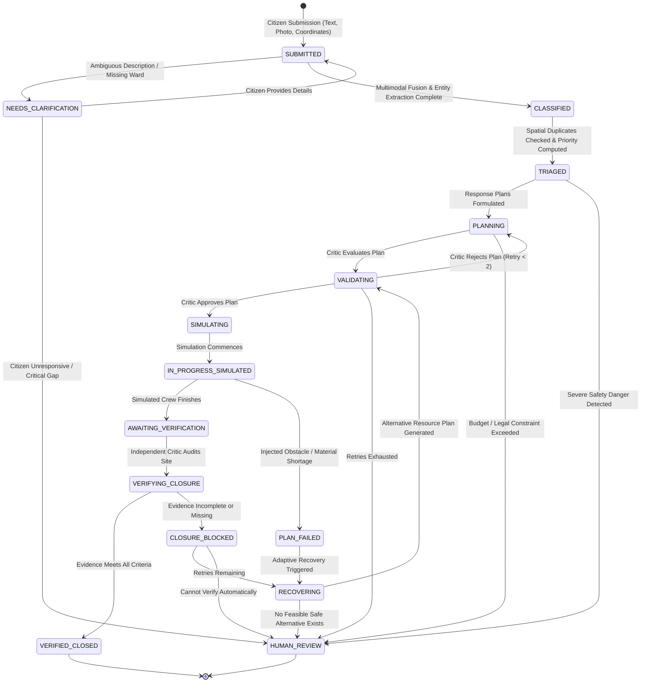

# JanSetu AI: Complete System Workflow & Technical Architecture Manual

> **Document Type:** Comprehensive Technical & Operational Manual  
> **Project:** JanSetu AI — ML-Powered Multi-Agent Civic Incident Resolution Workflow  
> **Scope:** Architecture, Agent Contracts, Orchestration State Machine, ML/DL Fusion, Deterministic Simulation, Digital Twin Persistence, REST APIs, and Frontend Interface  
> **Classification:** Academic CA-3 Agentic AI Proof of Concept  

---

## Table of Contents

1. [Executive Summary & Architectural Invariants](#1-executive-summary--architectural-invariants)
2. [End-to-End Incident Lifecycle & Workflow](#2-end-to-end-incident-lifecycle--workflow)
   - [Workflow State Transition Diagram](#workflow-state-transition-diagram)
   - [Step-by-Step Lifecycle Flow](#step-by-step-lifecycle-flow)
3. [Specialist Multi-Agent Architecture](#3-specialist-multi-agent-architecture)
   - [Agent 1: Incident Intelligence Agent](#agent-1-incident-intelligence-agent)
   - [Agent 2: Geo-Spatial Intelligence Agent](#agent-2-geo-spatial-intelligence-agent)
   - [Agent 3: Risk & Priority Agent](#agent-3-risk--priority-agent)
   - [Agent 4: Response Planning Agent](#agent-4-response-planning-agent)
   - [Agent 5: Adaptive Recovery Agent](#agent-5-adaptive-recovery-agent)
   - [Agent 6: Independent Verification Agent / Critic](#agent-6-independent-verification-agent--critic)
4. [Central Orchestrator & State Machine Engine](#4-central-orchestrator--state-machine-engine)
   - [LangGraph Directed Acyclic Graph (DAG)](#langgraph-directed-acyclic-graph-dag)
   - [Deterministic Transition Matrix](#deterministic-transition-matrix)
5. [ML/DL Intelligence & Multimodal Fusion Pipeline](#5-mldl-intelligence--multimodal-fusion-pipeline)
   - [NLP Multilingual Text Classifier](#nlp-multilingual-text-classifier)
   - [Vision & VLM Analysis Engine](#vision--vlm-analysis-engine)
   - [Late Multimodal Fusion Layer](#late-multimodal-fusion-layer)
6. [Deterministic Execution Simulator & Recovery Lab](#6-deterministic-execution-simulator--recovery-lab)
   - [Purpose and Simulation Constraints](#purpose-and-simulation-constraints)
   - [Failure Injections & Scenarios](#failure-injections--scenarios)
   - [Synthetic Municipal Resource Registry](#synthetic-municipal-resource-registry)
7. [Civic Incident Digital Twin & Database Schema](#7-civic-incident-digital-twin--database-schema)
   - [Relational Data Models (SQLite/SQLAlchemy)](#relational-data-models-sqlitesqlalchemy)
   - [Immutable Audit Trail & Correlation IDs](#immutable-audit-trail--correlation-ids)
8. [Interactive Frontend & Operator Experience](#8-interactive-frontend--operator-experience)
   - [Frontend Architecture & Tech Stack](#frontend-architecture--tech-stack)
   - [Core Application Views & Workspaces](#core-application-views--workspaces)
9. [Backend REST API Surface](#9-backend-rest-api-surface)
10. [Evaluation, Testing & Quality Assurance](#10-evaluation-testing--quality-assurance)
11. [Operational Setup & Demo Guide](#11-operational-setup--demo-guide)

---

## 1. Executive Summary & Architectural Invariants

**JanSetu AI** is an academic Agentic AI Proof of Concept designed to resolve civic infrastructure incidents—specifically **potholes**, **waterlogging**, and **garbage accumulation**—through an autonomous, auditable, and self-correcting multi-agent system.

Unlike conversational chatbots or single-prompt LLM wrappers, JanSetu AI implements an **autonomous engineering pipeline**:
- It ingests unstructured citizen reports (text, photos, geographic coordinates).
- It validates, disambiguates, and extracts factual civic entities.
- It clusters spatial duplicates and scores multi-factor municipal risk.
- It formulates dual-horizon response plans (`TEMPORARY_RELIEF` and `PERMANENT_RESOLUTION`).
- It tests these plans inside a **Deterministic Execution Simulator**.
- If obstacles or material shortages arise, it **adaptively recovers and replans**.
- Before any incident can be finalized, an **Independent Verification Critic** gates closure against physical completion evidence.

```
+---------------------------------------------------------------------------------------------------+
|                                      JANSETU AI ARCHITECTURE                                      |
+---------------------------------------------------------------------------------------------------+
|  [Citizen Ingestion] -> Text + Photo + Coordinates                                                |
|         |                                                                                         |
|         v                                                                                         |
|  [ML/DL Layer]       -> TF-IDF Multilingual NLP + VLM / Heuristic Vision -> Multimodal Late Fusion |
|         |                                                                                         |
|         v                                                                                         |
|  [Central Orchestrator] (LangGraph State Machine + Audit Trail)                                    |
|         |                                                                                         |
|         +---> Agent 1: Incident Intelligence (Entities, Missing Data, Clarifications)             |
|         |                                                                                         |
|         +---> [Parallel Branching]                                                                |
|         |       +---> Agent 2: GeoCivic (Haversine, TF-IDF Sim, DBSCAN Clusters, Duplicates)      |
|         |       +---> Agent 3: Risk & Priority (5-Factor Formula + Mandatory Danger Escalations)  |
|         |                                                                                         |
|         +---> Agent 4: Response Planning (Relief vs Permanent Plans + Resource Rostering)         |
|         |                                                                                         |
|         +---> Critic Gate (Plan Feasibility, Safety, Budget, Max 2 Retries)                       |
|         |                                                                                         |
|         +---> Deterministic Simulator (Synthetic Execution, Injected Obstacles)                   |
|         |       |                                                                                 |
|         |       +---> [On Failure] -> Agent 5: Adaptive Recovery (Constraint Re-plan)             |
|         |                                                                                         |
|         +---> Agent 6: Independent Verification Gate (Strict Evidence Audit)                      |
|         |                                                                                         |
|         v                                                                                         |
|  [Civic Incident Twin] -> SQLite Relational DB + Append-Only Audit Log + Correlation IDs          |
|         |                                                                                         |
|         v                                                                                         |
|  [React + Vite Frontend] -> Workspace, Command Center, Map Explorer, Simulation Lab, Analytics    |
+---------------------------------------------------------------------------------------------------+
```

### The 14 Non-Negotiable Invariants

Every module, agent, and API in JanSetu AI strictly complies with the following engineering invariants:

1. **No Fake Closures:** No incident may transition to `VERIFIED_CLOSED` without a passing `VerificationResult` containing valid completion criteria and evidence.
2. **Explicit Simulation Markers:** A simulated success is never described as a real-world repair. Every simulator output is stamped with `simulated=True` and flagged as `SIMULATED_RESOLVED` or `VERIFIED_CLOSED [Simulation]`.
3. **Non-Overridable Safety Escalations:** Mandatory danger escalation rules (e.g., exposed live electrical wires in water, hospital ambulance route blockages) immediately escalate to `HUMAN_REVIEW` and cannot be suppressed by a low numerical priority score.
4. **Bounded Replanning Cycles:** Replanning attempts are capped at `MAX_RETRIES = 2`. When the limit is reached, the incident halts and routes to `HUMAN_REVIEW`.
5. **Preservation of Failure History:** When an execution plan fails and an alternative is generated, the failed plan and execution attempt are retained in the database history rather than overwritten.
6. **Constraint-Respecting Alternatives:** The Adaptive Recovery Agent must only select alternative resources and methods that satisfy safety certifications and municipal contract authorizations.
7. **Similarity is Evidence, Not Proof:** High textual similarity and close geographic proximity between complaints are flagged as `UNCONFIRMED` duplicate candidates. **The system never auto-merges reports without human confirmation.**
8. **Graceful ML Degradation:** If an ML model (e.g., local Ollama VLM) is unavailable, the system marks `available=False` and degrades to heuristic fallbacks or operator prompts. **It never fabricates predictions.**
9. **Calibrated Confidence:** Model-reported confidence scores are explicitly marked as model-estimated probabilities and are never assumed to be calibrated ground truth.
10. **Empirical Metrics Only:** All dashboard metrics, KPI counters, and statistical charts are aggregated dynamically from database queries or runtime runs—never hard-coded.
11. **Clear Synthetic Labeling:** All synthetic datasets, mock municipal resources, and simulated crew dispatches are explicitly marked as `is_synthetic=True`.
12. **Input Immutability:** Raw citizen text and original images are stored immutably, completely separated from normalized, extracted, or model-inferred entities.
13. **Transactional Integrity:** Multi-entity state transitions are wrapped in atomic database transactions.
14. **No Phantom Capabilities:** Features not implemented in the PoC (such as real municipal telematics, live GPS trucks, or real citizen push notifications) are not claimed or fabricated.

---

## 2. End-to-End Incident Lifecycle & Workflow

### Workflow State Transition Diagram



### Step-by-Step Lifecycle Flow

#### Step 1: Ingestion & Multilingual Multimodal Intake
1. A citizen submits a complaint with:
   - Text description (English, Hindi, or transliterated Hinglish, e.g., *"bahut bada gaddha hai road par"*).
   - Photographic evidence (optional or required depending on the category).
   - Geo-coordinates (latitude, longitude) and landmark/ward.
2. The submission is assigned a unique `incident_id` (e.g., `INC-20261017-001`) and a root `correlation_id` (e.g., `corr_INC-20261017-001`).
3. Raw data is stored in the `incidents` table with `operational_status = "SUBMITTED"`.

#### Step 2: Multimodal Intelligence & Fusion
1. The **NLP Classifier** tokenizes text with TF-IDF and computes class probabilities for `pothole`, `waterlogging`, and `garbage`.
2. The **Vision Engine** checks image metadata, extracts visual features (dark depth depression, reflective liquid puddles, diffuse debris clusters), and queries the local VLM (Ollama) if available.
3. The **Late Fusion Layer** executes deterministic decision branches:
   - **Agreement:** NLP and Vision match $\rightarrow$ Combined confidence calculated.
   - **Disagreement:** Flags conflict $\rightarrow$ Status set to `NEEDS_CLARIFICATION`.
   - **Partial:** Only text or only vision available $\rightarrow$ Operates in single-modality mode with provenance stamped.

#### Step 3: Agent 1 - Incident Intelligence & Clarification
1. Reads fused output, validates that mandatory fields exist, and extracts structured entities (defect type, severity estimate, location landmark, hazard cues).
2. If vital information is missing or contradictory, it generates targeted clarification questions (e.g., *"Please specify if water is stagnant or flowing"*).
3. If valid, the incident transitions to `CLASSIFIED`.

#### Step 4: Parallel Branching (GeoCivic + Priority)
The Central Orchestrator forks execution into two parallel worker nodes:
- **Agent 2 (GeoCivic Intelligence):**
  - Calculates Haversine distances to existing open reports.
  - Computes TF-IDF cosine textual similarities.
  - Runs **DBSCAN clustering** ($\epsilon = 250\text{m}$, $\text{min\_samples} = 3$) to identify municipal hotspots.
  - Flags potential duplicate candidates as `UNCONFIRMED` for human review (never auto-merged).
- **Agent 3 (Risk & Priority Intelligence):**
  - Computes weighted municipal priority across 5 standardized factors (0.0 to 1.0).
  - Evaluates deterministic **Mandatory Danger Escalation Policies** (e.g., live electrical wires near water $\rightarrow$ immediate emergency).
4. Both branches join at the Orchestrator, advancing status to `TRIAGED`.

#### Step 5: Agent 4 - Dual-Track Response Planning
1. Formulates two coordinated response tracks:
   - `TEMPORARY_RELIEF`: Rapid containment (e.g., placing sandbags, deploying warning cones, pumping surface water) within 2–6 hours.
   - `PERMANENT_RESOLUTION`: Root-cause civil repair (e.g., cold-mix asphalt compaction, stormwater drain desilting) within 24–72 hours.
2. Defines:
   - Equipment and labor requirements.
   - Inter-task dependencies and safety permits.
   - Cost estimates and target SLAs.
   - **Explicit Closure Criteria Checklist** (e.g., compaction flush with grade, photographic proof archived, inspector sign-off).
3. Status advances to `PLANNING`.

#### Step 6: Critic Gate & Feasibility Validation
1. The **Critic Agent** evaluates the proposed plan against municipal policies:
   - Are estimated costs within designated thresholds?
   - Do resource requirements meet safety standards?
   - Is the SLA realistic for the priority tier?
2. If approved $\rightarrow$ transitions to `VALIDATING` $\rightarrow$ `SIMULATING`.
3. If rejected $\rightarrow$ returns to Planning with rejection reasons (max 2 retries).

#### Step 7: Deterministic Execution Simulation
1. The **Deterministic Execution Simulator** executes the approved plan using a deterministic random seed.
2. In academic or evaluation mode, scenarios can be injected:
   - `SUCCESS`: Normal execution.
   - `CREW_UNAVAILABLE`: Primary municipal gang is off-shift.
   - `MATERIAL_UNAVAILABLE`: Cold-mix asphalt batch shortage.
   - `WEATHER_BLOCK`: Heavy rain halts paving operations.
   - `COMPLETE_MISSING_EVIDENCE`: Crew finishes work but omits photo evidence.
3. If successful $\rightarrow$ generates an `ExecutionAttempt` record (`simulated=True`) and moves to `AWAITING_VERIFICATION`.
4. If an obstacle is encountered $\rightarrow$ transitions to `PLAN_FAILED` $\rightarrow$ `RECOVERING`.

#### Step 8: Agent 5 - Adaptive Recovery
1. Ingests the simulation failure reason and converts it into a formal mathematical constraint (e.g., `weather_safe == True`, `resource != res_crew_municipal_primary`).
2. Queries the **Synthetic Municipal Resource Registry**.
3. Ranks available substitute resources by cost, lead time, and safety certification.
4. Generates an updated plan version (e.g., Version 2: Standby Contractor Paving Team) while archiving Version 1.
5. Loops back to the Critic for re-validation.

#### Step 9: Agent 6 - Independent Verification Gate
1. Independent Critic audits the completed intervention before closure.
2. Compares:
   - Original citizen complaint criteria.
   - Approved plan closure requirements.
   - Post-intervention photographic and textual evidence.
   - Compaction, depth, and safety sign-offs.
3. **If all criteria pass:** Emits a signed `VerificationResult` (`passed=True`) and transitions status to `VERIFIED_CLOSED` (or `SIMULATED_RESOLVED` if running in simulation-only mode).
4. **If any criterion is unmet:** Blocks closure, issues `CLOSURE_BLOCKED`, and logs the exact deficient criteria.

#### Step 10: Digital Twin Persistence & UI Updates
1. Every state transition, agent decision, plan version, and simulation attempt is persisted in SQLite via transactional updates.
2. Structured audit events are appended to the incident's audit log with ISO timestamps and correlation IDs.
3. The React frontend refreshes telemetry in real time across the Workspace, Command Center, and Analytics Dashboard.

---

## 3. Specialist Multi-Agent Architecture

JanSetu AI's agents are not generic LLMs chatting in freeform text. Each agent is a **typed, bounded logical component** governed by strict Pydantic v2 schemas, dedicated deterministic guardrails, and explicit audit outputs.

```
+-------------------------------------------------------------------------------------------------+
|                                    AGENT RESPONSIBILITY MATRIX                                  |
+---+------------------------+---------------------------------------+----------------------------+
| # | Agent Name             | Primary Core Duty                     | Strict Guardrail           |
+---+------------------------+---------------------------------------+----------------------------+
| 1 | Incident Intelligence  | Multimodal intake, fact extraction,   | Never invent image facts   |
|   |                        | missing data detection, clarifications| or override user location  |
+---+------------------------+---------------------------------------+----------------------------+
| 2 | GeoCivic Intelligence  | Haversine distance, TF-IDF cosine     | Similarity is not proof;   |
|   |                        | similarity, DBSCAN spatial hotspots   | NEVER auto-merge duplicates|
+---+------------------------+---------------------------------------+----------------------------+
| 3 | Risk & Priority        | 5-factor weighted scoring formula +   | Low score NEVER overrides  |
|   |                        | mandatory danger escalation overrides | danger escalation policies |
+---+------------------------+---------------------------------------+----------------------------+
| 4 | Response Planning      | Dual-track plans (relief + permanent),| Advisory plans only;       |
|   |                        | resource rostering, closure criteria  | cannot bypass approvals    |
+---+------------------------+---------------------------------------+----------------------------+
| 5 | Adaptive Recovery      | Convert failure reason to constraint; | Must change plan based on  |
|   |                        | rank substitutes; bounded replanning  | blocker; bounded 2 retries |
+---+------------------------+---------------------------------------+----------------------------+
| 6 | Independent Critic     | Adversarial verification of closure   | Never trust planner claims;|
|   |                        | evidence against defined criteria     | photo alone != safe closure|
+---+------------------------+---------------------------------------+----------------------------+
```

---

### Agent 1: Incident Intelligence Agent
- **File:** [backend/app/agents/incident_intel.py](file:///c:/Users/tedha/OneDrive/Desktop/JanSetu%20AI/backend/app/agents/incident_intel.py)
- **Role:** First line of intake. Transforms unstructured citizen input and ML predictions into validated municipal facts.
- **Key Functions:**
  - `incident_intel_node(state)`: LangGraph execution node.
  - `extract_incident_facts(complaint, category, location, evidence_analysis)`: Extracts defect severity, road type, traffic blockage, and hazard cues.
  - `generate_clarification_questions(complaint, category, missing_fields)`: Formulates concise, targeted follow-ups.
- **Decision Logic:**
  - If the citizen text is less than 10 characters or lacks any identifiable defect keyword $\rightarrow$ sets `status = "NEEDS_CLARIFICATION"`.
  - If multimodal vision and NLP categories disagree $\rightarrow$ sets `status = "NEEDS_CLARIFICATION"` and requests category confirmation.
  - If valid $\rightarrow$ populates `extracted_facts` and updates `status = "CLASSIFIED"`.
- **Guardrail:** Cannot hallucinate road names or hazard conditions not evidenced in the complaint or visual features.

---

### Agent 2: Geo-Spatial Intelligence Agent
- **File:** [backend/app/agents/geocivic.py](file:///c:/Users/tedha/OneDrive/Desktop/JanSetu%20AI/backend/app/agents/geocivic.py)
- **Role:** Spatial and semantic deduplication and hotspot detection.
- **Mathematical Formulations:**
  - **Haversine Distance ($d$):**
    $$d = 2R \arcsin\left(\sqrt{\sin^2\left(\frac{\Delta\phi}{2}\right) + \cos(\phi_1)\cos(\phi_2)\sin^2\left(\frac{\Delta\lambda}{2}\right)}\right)$$
    *(where $R = 6,371,000\text{ m}$, $\phi$ is latitude, and $\lambda$ is longitude).*
  - **Textual Similarity:** TF-IDF vectorization across complaint texts followed by Cosine Similarity:
    $$\text{CosineSim}(A, B) = \frac{\mathbf{A} \cdot \mathbf{B}}{\|\mathbf{A}\|_2 \|\mathbf{B}\|_2}$$
  - **Duplicate Score:**
    $$\text{Score} = (0.6 \times \text{DistanceScore}) + (0.4 \times \text{TextualSimilarity})$$
    *(where $\text{DistanceScore} = \max(0, 1 - \frac{d}{100})$).*
  - **DBSCAN Hotspot Clustering:** Evaluates all active incidents in the ward with $\epsilon = 250\text{ meters}$ and $\text{min\_samples} = 3$. Incidents assigned to dense clusters are flagged with their cluster ID and density metrics.
- **Guardrail:** High scores generate `DuplicateCandidateModel` records with status `UNCONFIRMED`. **The agent is strictly prohibited from auto-merging or deleting reports.**

---

### Agent 3: Risk & Priority Agent
- **File:** [backend/app/agents/priority.py](file:///c:/Users/tedha/OneDrive/Desktop/JanSetu%20AI/backend/app/agents/priority.py)
- **Role:** Multi-factor objective municipal triage and safety escalation.
- **5-Factor Weighted Scoring Formula:**
  $$\text{PriorityScore} = \sum_{i=1}^{5} (w_i \times f_i)$$
  
  | Factor ($f_i$) | Weight ($w_i$) | Description & Criteria |
  |---|---|---|
  | **Hazard Severity** | $0.30$ | Pothole depth (>15cm), rapid water accumulation, toxic waste spill |
  | **Infrastructure Criticality**| $0.25$ | Arterial road, bridge approach, metro corridor, flyover ramp |
  | **Population Density** | $0.20$ | School zone, hospital entrance, busy market, transit hub |
  | **Weather Vulnerability** | $0.15$ | Monsoon season, active rainfall, forecast cyclone, flood zone |
  | **Time Degradation** | $0.10$ | Open duration without relief (>48h doubles score contribution) |

- **Priority Bands:**
  - $\ge 0.75$: **CRITICAL** (Target SLA: 4 hours)
  - $0.50 - 0.74$: **HIGH** (Target SLA: 12 hours)
  - $0.30 - 0.49$: **MEDIUM** (Target SLA: 24 hours)
  - $< 0.30$: **LOW** (Target SLA: 72 hours)
- **Mandatory Danger Escalation Rules (Hard Overrides):**
  - Exposed live electrical wires near waterlogging.
  - Pothole directly blocking hospital ambulance emergency bay.
  - Sewage contamination near school drinking water lines.
  - Structural subsidence on flyovers or bridges.
  *Rule Action:* Instantly sets `is_escalated = True`, overrides band to **CRITICAL**, and marks `status = "HUMAN_REVIEW"` if automated containment is unsafe.

---

### Agent 4: Response Planning Agent
- **File:** [backend/app/agents/resolution.py](file:///c:/Users/tedha/OneDrive/Desktop/JanSetu%20AI/backend/app/agents/resolution.py)
- **Role:** Generates actionable, structured civil engineering intervention plans.
- **Dual-Track Structure:**
  - **Track A: `TEMPORARY_RELIEF`**
    - Speed-optimized containment.
    - Example: Erecting high-visibility barricades, laying cold-patch aggregate, deploying 50 HP dewatering suction pumps.
  - **Track B: `PERMANENT_RESOLUTION`**
    - Quality-optimized structural restoration.
    - Example: Hot-mix asphalt milling, road base recompaction, drainage culvert reconstruction.
- **Plan Schema Requirements:**
  - Step-by-step action sequence with estimated hours.
  - Required resources (labor crew type, machinery, material batches).
  - Safety prerequisites (traffic police diversion permit, daytime lighting).
  - **Measurable Closure Criteria** (e.g., surface smoothness tolerance $< 5\text{mm}$, dry site photo, site supervisor physical sign-off).

---

### Agent 5: Adaptive Recovery Agent
- **File:** [backend/app/agents/recovery.py](file:///c:/Users/tedha/OneDrive/Desktop/JanSetu%20AI/backend/app/agents/recovery.py)
- **Role:** Responds to execution failures inside the Simulation Lab by synthesizing alternative plans under updated constraints.
- **Failure-to-Constraint Transformation:**
  - Failure: `"Cold-mix asphalt batch supply depleted at Central Depot"` $\rightarrow$ Constraint: `exclude_materials: ["cold_mix_asphalt_standard"]`, `require_material: "rapid_setting_polymer_asphalt"`.
  - Failure: `"Monsoon downpour exceeds 30mm/hr"` $\rightarrow$ Constraint: `weather_safe: True`, `delay_paving_hours: 6`, `mobilize_waterproof_canopy: True`.
  - Failure: `"Municipal crew shift expired"` $\rightarrow$ Constraint: `vendor_tier: "EMERGENCY_STANDBY_CONTRACTOR"`.
- **Alternative Selection:**
  - Filters `SYNTHETIC_RESOURCES` against new constraints.
  - Computes cost and schedule delta relative to the original plan.
  - Increments `retry_count`. If `retry_count > 2`, immediately routes incident to `HUMAN_REVIEW`.

---

### Agent 6: Independent Verification Agent / Critic
- **Files:** [backend/app/agents/critic.py](file:///c:/Users/tedha/OneDrive/Desktop/JanSetu%20AI/backend/app/agents/critic.py) & [backend/app/agents/verification.py](file:///c:/Users/tedha/OneDrive/Desktop/JanSetu%20AI/backend/app/agents/verification.py)
- **Role:** Adversarial auditor. Acts as an uncompromised gatekeeper between simulated intervention and closure.
- **Verification Audit Rules:**
  1. Compares post-execution evidence against the approved plan's closure criteria list.
  2. Checks for photographic completion evidence: Must show cleared defect, clean surroundings, and restored traffic flow.
  3. Verifies compaction and safety inspector sign-offs.
  4. Checks for synthetic simulation markers: Confirms all records reflect simulated reality.
- **Gate Outcomes:**
  - **Passed:** Issues `VerificationResult(passed=True, result="VERIFIED")` $\rightarrow$ Transitions to `VERIFIED_CLOSED`.
  - **Deficient Evidence:** Issues `VerificationResult(passed=False, result="CLOSURE_BLOCKED")` with a list of missing items (e.g., *"Photographic completion evidence missing"*, *"Field compaction sign-off absent"*).
  - **Unresolvable Defect:** Emits `REOPENED` or `HUMAN_REVIEW`.

---

## 4. Central Orchestrator & State Machine Engine

### LangGraph Directed Acyclic Graph (DAG)

The Central Orchestrator ([backend/app/graph/orchestrator.py](file:///c:/Users/tedha/OneDrive/Desktop/JanSetu%20AI/backend/app/graph/orchestrator.py)) compiles a LangGraph state machine where nodes correspond to agents and gates, and edges enforce conditional deterministic routing.

```
                  +-------------------+
                  |       START       |
                  +---------+---------+
                            |
                            v
               +------------+------------+
               |     incident_intel      |
               +------------+------------+
                            |
                 [route_from_intake]
               /            |            \
    (Needs Info)        (Matched)         (Uncertain)
            /               |               \
           v                v                v
        [ END ]     +-------+-------+     [ END ]
                    |               |
                    v               v
            +---------------+ +---------------+
            |   geocivic    | | priority_intel|
            +-------+-------+ +-------+-------+
                    |                 |
                    +--------+--------+
                             |  [Parallel Join]
                             v
               +-------------+-------------+
               |    resolution_planning    |
               +-------------+-------------+
                             |
                   [route_from_planning]
                             |
                             v
               +-------------+-------------+
         +---> |          critic           | <---+
         |     +-------------+-------------+     |
         |                   |                   |
  (Reject|           [route_from_critic]         |
  Retry<2)        /          |          \        | (Re-validate)
         |       v           v           v       |
         +-- [planning]  [simulate]    [ END ]   |
                             |      (Escalated)  |
                   [route_from_sim]              |
                   /               \             |
             (Failure)           (Success)       |
                 v                   v           |
      +-------------------+ +-----------------+  |
      | adaptive_recovery | |  closure_gate   |  |
      +---------+---------+ +--------+--------+  |
                |                    |           |
                +--------------------+-----------+
```

### Deterministic Transition Matrix

The state machine ([backend/app/graph/state_machine.py](file:///c:/Users/tedha/OneDrive/Desktop/JanSetu%20AI/backend/app/graph/state_machine.py)) strictly enforces allowed state changes. Any call attempting an unregistered transition raises a `TransitionError`.

| Current Operational Status | Allowed Next States |
|---|---|
| `SUBMITTED` | `NEEDS_CLARIFICATION`, `CLASSIFIED` |
| `NEEDS_CLARIFICATION` | `CLASSIFIED`, `HUMAN_REVIEW` |
| `CLASSIFIED` | `TRIAGED` |
| `TRIAGED` | `PLANNING`, `VALIDATING`, `HUMAN_REVIEW` |
| `PLANNING` | `AWAITING_AUTHORIZATION`, `IN_PROGRESS_SIMULATED`, `VALIDATING`, `SIMULATING`, `ESCALATED`, `HUMAN_REVIEW` |
| `AWAITING_AUTHORIZATION` | `IN_PROGRESS_SIMULATED`, `HUMAN_REVIEW` |
| `IN_PROGRESS_SIMULATED` | `AWAITING_VERIFICATION`, `PLAN_FAILED` |
| `PLAN_FAILED` | `REPLANNING`, `RECOVERING`, `HUMAN_REVIEW` |
| `REPLANNING` | `PLANNING`, `VALIDATING`, `HUMAN_REVIEW` |
| `RECOVERING` | `VALIDATING`, `PLANNING`, `ESCALATED`, `HUMAN_REVIEW` |
| `AWAITING_VERIFICATION` | `VERIFIED_CLOSED`, `SIMULATED_RESOLVED`, `VERIFICATION_FAILED`, `CLOSURE_BLOCKED` |
| `CLOSURE_BLOCKED` | `REPLANNING`, `RECOVERING`, `HUMAN_REVIEW`, `ESCALATED`, `AWAITING_VERIFICATION`, `VERIFIED_CLOSED`, `SIMULATED_RESOLVED` |
| `VERIFICATION_FAILED` | `REOPENED`, `REPLANNING`, `HUMAN_REVIEW`, `AWAITING_VERIFICATION`, `VERIFIED_CLOSED` |
| `REOPENED` | `TRIAGED`, `PLANNING` |
| `HUMAN_REVIEW` | *Terminal State* |
| `VERIFIED_CLOSED` | *Terminal State* |
| `SIMULATED_RESOLVED` | *Terminal State* |

---

## 5. ML/DL Intelligence & Multimodal Fusion Pipeline

JanSetu AI's machine learning subsystem ([backend/app/ml/](file:///c:/Users/tedha/OneDrive/Desktop/JanSetu%20AI/backend/app/ml/)) processes messy, multimodal inputs through a decoupled architecture.

```
[Raw Citizen Complaint Text]                     [Citizen Photo Upload]
             |                                             |
             v                                             v
+--------------------------+                 +----------------------------+
|  NLP Classifier          |                 |  Vision Engine (VLM/Local) |
|  - TF-IDF Vectorizer     |                 |  - Ollama VLM (LLaVA/Qwen) |
|  - Multiclass Classifier |                 |  - Heuristic Feature Extr. |
|  - English + Hinglish    |                 |  - Color, Depth, Texture   |
+------------+-------------+                 +--------------+-------------+
             |                                              |
     (NLPPrediction)                               (VisionPrediction)
             \                                              /
              \                                            /
               v                                          v
        +--------------------------------------------------------+
        |             Multimodal Late Fusion Layer               |
        |  - Agreement Matrix (Pothole/Water/Garbage)            |
        |  - Confidence Calibration & Disagreement Flagging       |
        |  - Provenance Tracking (Direct, Fallback, Manual)      |
        +---------------------------+----------------------------+
                                    |
                                    v
                       (MultimodalFusionResult)
```

### NLP Multilingual Text Classifier
- **Module:** [backend/app/ml/nlp_classifier.py](file:///c:/Users/tedha/OneDrive/Desktop/JanSetu%20AI/backend/app/ml/nlp_classifier.py)
- **Design:** TF-IDF n-gram feature extractor (1-word and 2-word n-grams) combined with a calibrated multiclass linear classifier.
- **Multilingual Vocabulary:** Trained on authentic civic vocabulary including:
  - English: *"deep crater in middle of road"*, *"drain overflow during rain"*, *"stinking garbage pile"*.
  - Hindi / Hinglish: *"bahut bada gaddha hai"*, *"sadak toot gayi hai"*, *"paani bhar gaya pura rasta block"*, *"kachra pada hai badbu aa rahi hai"*.
- **Output:** Category prediction (`pothole`, `waterlogging`, `garbage`, or `uncertain_other`), probability distribution over classes, and model-reported confidence.

### Vision & VLM Analysis Engine
- **Module:** [backend/app/ml/vision.py](file:///c:/Users/tedha/OneDrive/Desktop/JanSetu%20AI/backend/app/ml/vision.py)
- **Design:** Dual-path inspection engine:
  - **Primary:** Integration with local Ollama VLM (e.g., LLaVA or Qwen2-VL) running locally on port 11434. Sends prompt querying for defect classification, surface depth, standing water reflection, and debris spread.
  - **Fallback:** Rule-based computer vision heuristic extractor that computes image brightness gradients, dark depression contours (pothole indicators), specular reflection ratios (water indicators), and color entropy (garbage cluster indicators).
- **Graceful Fallback:** If Ollama is offline, `available` is set to `False` and the fallback heuristic takes over with `fallback_provenance = "heuristic_cv"`.

### Late Multimodal Fusion Layer
- **Module:** [backend/app/ml/fusion.py](file:///c:/Users/tedha/OneDrive/Desktop/JanSetu%20AI/backend/app/ml/fusion.py)
- **Six Deterministic Fusion Cases:**
  1. **Case A (Agreement):** Both modalities predict the same category $\rightarrow$ category accepted; confidence computed via weighted average:
     $$\text{Confidence}_{\text{fused}} = 0.55 \times \text{Conf}_{\text{NLP}} + 0.45 \times \text{Conf}_{\text{Vision}}$$
  2. **Case B (Disagreement):** Modalities predict conflicting classes $\rightarrow$ `disagreement_detected = True`, category set to `None`, routed to `NEEDS_CLARIFICATION`.
  3. **Case C (NLP Only):** Image is missing or unreadable $\rightarrow$ category adopted from NLP, vision marked `available=False`, provenance marked `partial`.
  4. **Case D (Vision Only):** Text is absent or empty $\rightarrow$ category adopted from Vision, NLP marked `available=False`.
  5. **Case E (Both Unavailable):** Both models fail or inputs are blank $\rightarrow$ requires manual operator selection; tagged `is_model_prediction=False`.
  6. **Case F (Missing Required Fields):** Required geographic or landmark fields missing $\rightarrow$ flags targeted questions without guessing coordinates.

---

## 6. Deterministic Execution Simulator & Recovery Lab

### Purpose and Simulation Constraints
In an academic CA-3 Proof of Concept, contacting actual municipal dispatch trucks or sending physical repair crews is neither permissible nor feasible. JanSetu AI solves this with a **Deterministic Execution Simulator** ([backend/app/simulation/simulator.py](file:///c:/Users/tedha/OneDrive/Desktop/JanSetu%20AI/backend/app/simulation/simulator.py)).

- Simulates field work under explicit, seeded conditions (`seed=42`).
- Emits fully typed `ExecutionAttempt` records with `simulated = True`.
- Provides an academic demonstration of self-correcting agentic behavior without any risk of real-world disruption.

### Failure Injections & Scenarios
The simulator supports 6 explicit testing scenarios:

```
+------------------------------------+---------------------------------------------------------------+
| Scenario Name                      | Injected Obstacle / Simulation Condition                      |
+------------------------------------+---------------------------------------------------------------+
| SUCCESS                            | Normal field deployment; all repair criteria satisfied        |
| CREW_UNAVAILABLE                   | Primary municipal gang is on scheduled leave or reassigned    |
| MATERIAL_UNAVAILABLE               | Asphalt hot-mix or cold-patch batch inventory depleted       |
| WEATHER_BLOCK                      | Monsoon rainfall exceeds safety threshold for paving          |
| RELIEF_EXPIRED                     | Temporary barricade destroyed by storm; requires reinstitution|
| COMPLETE_MISSING_EVIDENCE          | Physical work simulated, but crew omits photo evidence        |
+------------------------------------+---------------------------------------------------------------+
```

### Synthetic Municipal Resource Registry

The simulator maintains a synthetic roster of municipal assets with explicit operational constraints:

| Resource ID | Resource Name | Type | Affinity | Safety Certified | Weather Safe | Lead Time | Cost |
|---|---|---|---|---|---|---|---|
| `res_crew_municipal_primary` | Primary Municipal Road Gang | Crew | pothole, all | Yes | **No** (halts in rain) | 2.0 h | ₹5,000 |
| `res_crew_contractor_standby` | Emergency Standby Paving Team | Crew | pothole, all | Yes | **Yes** (all-weather) | 1.0 h | ₹12,000 |
| `res_pump_submersible_50hp` | High-Volume 50HP De-watering Pump | Equipment | waterlogging | Yes | Yes | 0.5 h | ₹8,500 |
| `res_crew_drainage_rapid` | Monsoon Drainage Clearing Unit | Crew | waterlogging | Yes | Yes | 1.5 h | ₹7,200 |
| `res_tipper_truck_10ton` | 10-Ton Hydraulic Compactor Tipper | Equipment | garbage, all | Yes | Yes | 1.0 h | ₹4,500 |
| `res_crew_sanitation_emergency`| Emergency Solid Waste Squad | Crew | garbage | Yes | Yes | 1.0 h | ₹3,800 |
| `res_crew_uncertified_labor` | Casual Uncertified Labor Gang | Crew | all | **No** | No | 0.5 h | ₹1,500 |

> **Adaptive Recovery Guardrail:** When the Primary Road Gang fails due to monsoon weather, Adaptive Recovery **must reject** `res_crew_uncertified_labor` because `safety_certified == False`, and must select `res_crew_contractor_standby` because it is certified and weather-safe.

---

## 7. Civic Incident Digital Twin & Database Schema

The **Civic Incident Digital Twin** ([backend/app/db/models.py](file:///c:/Users/tedha/OneDrive/Desktop/JanSetu%20AI/backend/app/db/models.py) and [twin_service.py](file:///c:/Users/tedha/OneDrive/Desktop/JanSetu%20AI/backend/app/twin/twin_service.py)) represents the single source of truth for all operational states, historical decisions, and audit events.

### Relational Data Models (SQLite/SQLAlchemy)

```
   +--------------------------------------------------------+
   |                       incidents                        |
   +--------------------------------------------------------+
   | PK incident_id             VARCHAR(64)                 |
   |    complaint               TEXT                        |
   |    category                VARCHAR(64)                 |
   |    location_data           JSON                        |
   |    operational_status      VARCHAR(64)                 |
   |    evidence_status         VARCHAR(64)                 |
   |    extracted_facts         JSON                        |
   |    evidence_analysis       JSON                        |
   |    geo_context             JSON                        |
   |    priority                JSON                        |
   |    current_plan            JSON                        |
   |    validation              JSON                        |
   |    closure_evidence        JSON                        |
   |    verification_result     JSON                        |
   |    simulation_result       VARCHAR(64)                 |
   |    retry_count             INTEGER                     |
   |    created_at / updated_at DATETIME                    |
   +---------------------------+----------------------------+
                               | 1
                               |
            +------------------+------------------+------------------+
            | 1..N             | 1..N             | 1..N             | 1..N
            v                  v                  v                  v
+-----------------------+ +----------------+ +------------------+ +------------------+
|   model_predictions   | | response_plans | |execution_attempts| |  audit_events    |
+-----------------------+ +----------------+ +------------------+ +------------------+
| PK prediction_id      | | PK plan_id     | | PK attempt_id    | | PK event_id      |
| FK incident_id        | | FK incident_id | | FK incident_id   | | FK incident_id   |
|    task_type          | |    plan_type   | |    resource      | |    timestamp     |
|    predicted_label    | |    version     | |    outcome       | |    agent         |
|    scores (JSON)      | |    status      | |    failure_reason| |    action        |
|    fallback_provenance| |    actions     | |    simulated=True| |    correlation_id|
|    is_synthetic=True  | |    cost/hours  | |    attempted_at  | |    result        |
+-----------------------+ +----------------+ +------------------+ +------------------+
```

### Immutable Audit Trail & Correlation IDs

Every state modification appends an entry to the `audit_events` table:
```json
{
  "event_id": "evt_7f8a12bc",
  "incident_id": "INC-20261017-001",
  "correlation_id": "corr_INC-20261017-001",
  "timestamp": "2026-10-17T10:15:30.124Z",
  "agent": "Risk & Priority Intelligence Agent",
  "action": "Calculated Multi-Factor Priority",
  "result": "Assigned CRITICAL priority (score: 0.82) due to school zone proximity.",
  "outcome": "SUCCESS",
  "event_type": "decision"
}
```
The audit trail is append-only. No agent, operator, or script can alter or delete historical audit entries.

---

## 8. Interactive Frontend & Operator Experience

The frontend is a modern web application built with **React 18**, **Vite**, **TypeScript**, and styled with **Vanilla CSS** and curated Tailwind tokens.

```
+-------------------------------------------------------------------------------------------------+
|                                JANSETU AI UNIFIED WORKSPACE UI                                  |
+-------------------------------------------------------------------------------------------------+
| [Header]: JanSetu AI Logo | System Health Pill (Online/Offline) | DB Stats | Latency Monitor     |
| [Nav Tabs]: Operations | Explorer | Submit | Incident Workspace | Command Center | Sim Lab | ML |
+-------------------------------------------------------------------------------------------------+
|                                                                                                 |
|  +-------------------------------------------------------------------------------------------+  |
|  | Active View: Incident Workspace (Interactive 6-Step Orchestration Stepper)              |  |
|  +-------------------------------------------------------------------------------------------+  |
|  |                                                                                           |  |
|  | [Step 1: Intake] -> [Step 2: Geo/Triage] -> [Step 3: Plan] -> [Step 4: Validate] -> ...   |  |
|  |                                                                                           |  |
|  |  +---------------------------------------+  +------------------------------------------+  |  |
|  |  | Left Panel: Incident Details         |  | Right Panel: Multi-Agent Intelligence    |  |  |
|  |  | - Complaint Text & Multilingual Badges|  | - Agent Reasoning Stream                 |  |  |
|  |  | - Photo Preview & Vision Highlights   |  | - Fused Confidence Scores                |  |  |
|  |  | - Location Map Coordinates & Ward     |  | - Dual Plan Viewer (Relief vs Permanent) |  |  |
|  |  | - Status Badge & Priority Indicator   |  | - Simulation Scenario Injector           |  |  |
|  |  +---------------------------------------+  | - Verification Audit Checklist           |  |  |
|  |                                             +------------------------------------------+  |  |
|  +-------------------------------------------------------------------------------------------+  |
|                                                                                                 |
+-------------------------------------------------------------------------------------------------+
```

### Core Application Views

1. **Executive Operations Dashboard (`DashboardView.tsx`):**
   - Live KPI overview: Total Incidents, In-Progress Interventions, Verification Success Rate, and Active SLA Compliance.
   - Hotspot density distribution and category breakdown charts.
   - Real-time audit activity feed displaying agent actions as they execute.

2. **Citizen Submission Portal (`CitizenSubmissionForm.tsx`):**
   - Clean, user-friendly form accepting complaint text, image upload, and map coordinate picking.
   - Real-time ML preview showing instant NLP and vision categorization before submission.

3. **Incident Workspace (`IncidentWorkspaceView.tsx`):**
   - The central operational workspace.
   - Features an interactive **6-Stage Lifecycle Stepper**:
     1. Intake & Multimodal Intelligence
     2. Geo-Spatial Context & Deduplication
     3. Priority Assessment & Risk Scoring
     4. Dual-Track Response Planning
     5. Execution Simulation & Recovery
     6. Independent Verification & Closure Audit
   - Interactive controls allow operators to step forward, inject obstacles, review candidate duplicates, approve plan overrides, or trigger full autonomous runs.

4. **Agent Command Center (`AgentCommandCenterView.tsx`):**
   - Visualizes the live LangGraph execution pipeline.
   - Shows active node states, latency per agent, payload inspectors, and real-time streaming agent execution logs.

5. **Spatial & Hotspot Explorer (`IncidentExplorerView.tsx`):**
   - Interactive GIS map view displaying incidents across municipal wards.
   - Visualizes DBSCAN cluster boundaries, hotspot density gradients, and candidate duplicate connection vectors.

6. **Simulation & Failure Lab (`SimulationLabView.tsx`):**
   - Stress-testing workbench for academic evaluation.
   - Allows users to select any incident, inject specific failure modes (e.g., `WEATHER_BLOCK` or `MATERIAL_UNAVAILABLE`), and watch the Adaptive Recovery Agent replan in real time.

7. **ML Model Diagnostic Lab (`MLModelLabView.tsx`):**
   - Interactive testing playground for NLP and Vision models.
   - Allows operators to test arbitrary Hindi/English text strings and images to inspect raw vector embeddings, logits, and late-fusion decision trees.

---

## 9. Backend REST API Surface

The FastAPI backend exposes a modular REST API configured under `/api`:

### Incident Lifecycle & Management (`/api/incidents`)
- `GET /api/incidents`: List all incidents with optional filtering by status, category, priority, and ward.
- `POST /api/incidents`: Ingest a new citizen complaint (supports multipart form data with image upload).
- `GET /api/incidents/{incident_id}`: Retrieve full incident record, including all agent outputs, plans, and audit history.
- `POST /api/incidents/{incident_id}/step`: Execute a single discrete agent step in the LangGraph workflow.
- `POST /api/incidents/{incident_id}/run`: Execute the complete end-to-end workflow until a terminal state is reached.
- `POST /api/incidents/{incident_id}/simulate`: Run the Deterministic Execution Simulator with an optional scenario parameter.
- `POST /api/incidents/{incident_id}/clarify`: Submit citizen clarification answers to resume a halted incident.
- `POST /api/incidents/{incident_id}/human-correction`: Record an authorized human override with justification.
- `POST /api/incidents/{incident_id}/duplicates/{candidate_id}/confirm`: Confirm or reject an unconfirmed duplicate match.

### Operational Dashboard & Analytics (`/api/dashboard`)
- `GET /api/dashboard/stats`: Aggregated system metrics (total counts, SLA compliance percentage, active clusters, agent latency percentiles).
- `GET /api/dashboard/hotspots`: GeoJSON-formatted cluster data derived from DBSCAN spatial grouping.

### ML Diagnostic & Evaluation (`/api/ml`)
- `POST /api/ml/classify-text`: Direct endpoint for the NLP Multilingual Classifier.
- `POST /api/ml/analyze-image`: Direct endpoint for the Vision/VLM Analysis Engine.
- `POST /api/ml/fuse`: Direct endpoint for the Late Multimodal Fusion Layer.

### System Health (`/api/health`)
- `GET /api/health`: Returns service health, SQLite database connectivity status, and local Ollama VLM reachability.

---

## 10. Evaluation, Testing & Quality Assurance

JanSetu AI is verified by an automated test and evaluation suite:

### Test Suite Execution
- **Command:** `pytest backend/tests/ -v`
- **Coverage:** 194 automated unit and integration tests covering:
  - Multilingual NLP tokenization and edge cases.
  - VLM heuristic fallback degradation.
  - Fusion truth tables across all 6 cases.
  - Haversine and DBSCAN cluster correctness.
  - Risk formula edge cases and mandatory danger escalations.
  - Dual plan generation and resource constraints.
  - Simulator failure scenario emissions.
  - Adaptive Recovery constraint synthesis and retry limits.
  - Deterministic state machine transition gating.
  - API endpoint contracts and error handling.

### Independent Evaluation Harness
- **Command:** `python eval/run_validation.py`
- **Result:** **11/11 Validation Checks Passed (100% Compliant)**
  - Verifies that no incident in the database is in `VERIFIED_CLOSED` without a passing `VerificationResult`.
  - Verifies that every simulation record contains `simulated=True`.
  - Verifies that mandatory danger rules triggered on all hazardous test fixtures.
  - Verifies that retry ceilings halted at `MAX_RETRIES = 2`.
  - Verifies that failed plans are preserved in history.
  - Verifies that no uncertified resources were selected by Adaptive Recovery.

---

## 11. Operational Setup & Demo Guide

### Prerequisites
- Python 3.11+
- Node.js 18+ and npm
- *(Optional)* Ollama running locally with `ollama run llava` for local vision capabilities.

### Starting the System

#### 1. Backend Service (FastAPI)
```bash
# Navigate to backend directory
cd backend

# Activate virtual environment
# Windows:
..\.venv\Scripts\activate
# Linux/macOS:
source ../.venv/bin/activate

# Install dependencies (if not already installed)
pip install -r requirements.txt

# Start backend server on port 8000
uvicorn app.main:app --host 0.0.0.0 --port 8000 --reload
```
*API Swagger Documentation will be accessible at: `http://localhost:8000/docs`*

#### 2. Frontend Web Application (React + Vite)
```bash
# Open a new terminal and navigate to frontend directory
cd frontend

# Install dependencies
npm install

# Start development dev server on port 5173
npm run dev
```
*Web Application will be accessible at: `http://localhost:5173`*

---

### Live 5-Minute Demonstration Script

For academic review, presentations, or evaluations, follow this verified demonstration sequence:

| Timestamp | Phase | Action in UI | Highlight for Evaluator |
|---|---|---|---|
| **0:00 - 0:45** | **Citizen Intake** | Open **Submit** tab. Paste Hindi text: *"Station road par bahut bada gaddha hai, car ka pahiya toot gaya"*. Attach a pothole photo. Click Submit. | Show real-time ML classification preview. Highlight multilingual NLP handling without external translation APIs. |
| **0:45 - 1:30** | **Multimodal Fusion & Intake** | Open **Incident Workspace**. Observe **Agent 1** output. | Point out extracted structured entities (defect type, severity). Show that raw input remains immutable. |
| **1:30 - 2:30** | **Geo & Priority Intelligence** | Step forward to **Geo & Triage**. View the map. | Point out the Haversine distance check and DBSCAN cluster assignment. Show the 5-factor priority score calculation (0.84 - CRITICAL). Show how proximity to the station triggered safety escalation. |
| **2:30 - 3:15** | **Response Planning & Critic** | Advance to **Planning**. View the dual tabs. | Show the distinct `TEMPORARY_RELIEF` plan (cones & rapid cold patch in 2h) vs `PERMANENT_RESOLUTION` plan (milling & asphalt in 24h). Point out the defined closure checklist. |
| **3:15 - 4:15** | **Simulation Failure & Adaptive Recovery** | In the **Simulation Lab** panel, select scenario: `WEATHER_BLOCK` (monsoon rain). Click Simulate. | Watch the simulation fail. Notice the state change to `PLAN_FAILED` $\rightarrow$ `RECOVERING`. Show **Agent 5 (Adaptive Recovery)** turning the failure into a `weather_safe == True` constraint and swapping to the standby contractor team. |
| **4:15 - 5:00** | **Independent Verification & Audit** | Click **Step to Verification**. | Show **Agent 6** auditing the closure evidence against the checklist. Show the state change to `VERIFIED_CLOSED [Simulation]`. Scroll down to the **Immutable Audit Trail** to demonstrate complete end-to-end provenance with correlation IDs. |

---

*Manual maintained by the JanSetu AI Core Engineering Team. Single source of truth for architecture and operational verification.*
